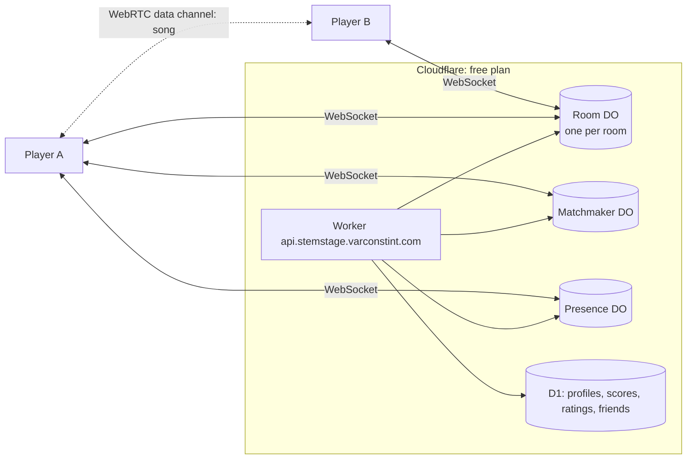

# STEMSTAGE 3.5: online, rebuilt (plan)

*Status: plan, written 2026-10-31 after 3.0 shipped. Nothing here is built yet.*

3.5 rebuilds online play so it's easy to start, keeps going when people drop, and lets you **hear your band**. It stays on free tiers, in the Cloudflare account the leaderboard API already uses.

## Where online is today (3.0)

| Piece | How it works | What hurts |
|---|---|---|
| Rooms | A Node WebSocket server on the **host's PC** (`server/online.js`), reached through a Cloudflare quick tunnel (`server/tunnel.js`). The invite code is the tunnel's four words | The host must keep the game open, and the room dies when they quit. The first host downloads `cloudflared` (~55 MB). Quick tunnels have no uptime promise and some networks block them. Joining takes seconds |
| Songs | Friends download the song from the host through the tunnel (Opus, ~25 MB for 4 min, `server/transcode.js`) | Limited by the host's upload speed and the tunnel, once per friend. Slow for big rooms |
| Sync | `startAt` in server time; clients estimate the clock offset from pings (EMA, `src/net/online.js`) | No minimum-RTT filtering, so jittery links start a little off |
| Live data | Each player sends a score summary about 8 times a second (`live`: score, streak, mult, overdrive, crowd, audible) | You can't hear or see what bandmates actually play. In band mode their stems are just muted or unmuted |
| Matchmaking | Hosts list rooms in D1. Searchers poll `POST /v1/match` with a ticket (`cloud/src/index.js`, `cloud/src/match.js`) | Polling. A matchmade room still lives on someone's PC. No parties or friends |
| Versions | Rooms refuse a different **minor** version (`minor()` in `server/online.js`) | 3.0 and 3.1 can't play together, and the website had to hard-code the version (fixed with the 3.0 site update) |
| Trust | Each client reports its own result | Nothing checks it |

## Goals

1. **Rooms in the cloud:** no tunnel or download, rooms survive the host leaving, joining is instant.
2. **Songs go player to player and are never stored on a server.** Skip the transfer when a friend already has the song.
3. **Tighter sync:** everyone starts on the same beat, and a dropped connection rejoins mid-song.
4. **Hear your band:** in band mode each bandmate's part plays as [live notes](../../wiki/Live-Notes.md) on your machine. Their misses go quiet and their solos are theirs.
5. **Social:** friends, presence, parties that queue together, and in-game invites.
6. **New modes on 3.0's systems:** co-op Runs, a section-by-section royale, tournaments with spectators, and async "beat my run" challenges.
7. **Fair results:** scores are recomputed from note events and cross-checked.
8. **Free tier:** with an honest budget and a graceful fallback when it runs out.

## Architecture

- **Room = one Durable Object.** The Worker routes `wss://api.stemstage.varconstint.com/v2/room/<CODE>` to the object for that code.
  - It holds the room state that lives in `server/online.js` today: lobby, opts, lineup, history, rematch, bans.
  - It uses the **WebSocket Hibernation API**, so idle lobbies cost next to nothing.
  - It's created near its first player (location hint from `request.cf`).
- **Codes stay four words** (`POTTER-SIMON-FLORAL-EDGES`). The Worker makes them instead of the tunnel, so the join page and `stemstage://join/<code>` links keep working.
- **Host migration:** if the host drops, the earliest-joined player becomes host. The room ends when it empties, not when the host leaves.
- **Matchmaker DO** replaces D1 polling. Searchers hold a WebSocket and get a room pushed to them. The ranking stays the pure `pickRoom` / `scoreRoom` in `cloud/src/match.js` (already unit-tested).
- **Presence DO:** one connection per signed-in player while the game is open, hibernated when quiet. It handles friends' status (online, in a room, playing *song*), invites and party state.
- **Direct host stays as a fallback:** the 3.0 room server and quick tunnel remain as *Host on this PC* (LAN, or when the cloud is unavailable).

### Room protocol v2

JSON over WebSocket, versioned by **protocol number**, not app version: `hello{proto: 2, app: "3.5.1", …}`. Any 3.5.x client can play with any other. A future breaking change bumps `proto`, and the room says exactly which update you need.

Messages carried over from v1 (`server/online.js` header): `hello`, `set`, `select`, `mode`, `opts`, `kick`, `have`, `start`, `rematch`, `chat`, `react`, `result`.

| New / changed | |
|---|---|
| `sync{c}` → `synced{c, s}` | A burst of 8 at join and before each start; the client keeps the sample with the lowest round trip |
| `start{startAt, …}` | `startAt` = now + max(3 s, 2 × slowest RTT + load margin). Sent only after every player reports `loaded` |
| `ev{seq, at, e: [[k, d], …]}` | Note events about 10 times a second per player: group `k` hit `d` ms off, or missed (`d = null`), plus sustains and whammy. This replaces most of `live` |
| `snap` | The room's latest state for a player who reconnects or spectates mid-song: everyone's score, events so far, boss state |
| `signal{to, sdp\|ice}` | WebRTC signalling for song transfer |
| `relay{to, chunk}` | Song chunks through the room when peer-to-peer fails (capped; see budget) |
| `host{id}` | Host migration |

### Songs: peer to peer, never stored

1. **Skip it:**
   - When a friend's library has the same song (by fingerprint, `src/audio/fingerprint.js`), nothing is sent. The ranked chart is already lined up with each player's recording.
   - When the room plays a ranked chart, only the chart travels (D1).
2. **Peer to peer:** a WebRTC data channel from the host (or anyone who has the song) to each player.
   - Opus stems as today, in 64 KB chunks, with progress in the lobby.
   - Signalling goes through the room DO, with public STUN only.
3. **Relay:** if the peer connection fails (symmetric NAT, or no WebRTC in the Linux build), chunks go through the room DO. This path is capped at one song per match and rate-limited.
4. **Last resort:** the 3.0 path, downloading from a *Host on this PC* room through its tunnel.

Songs never sit on a Cloudflare server: they pass through memory on the relay path only. That keeps STEMSTAGE out of hosting other people's music.

### Netcode: one clock, shared notes

- **Clock:** take the minimum-RTT sample from an 8-ping burst (NTP style), then track drift with a ping every 5 s. Today's EMA mixes jitter into the offset.
- **Start:** everyone schedules audio for `startAt` in server time. Expect a start spread under ~10 ms on normal home connections; measure it in phase 0.
- **Note events** (`ev`) are the source of truth for what each player played. They drive:
  - **Hear your band:** each bandmate's part runs through `LiveStem` locally. Their notes start on time by themselves (the speculative path that 3.0 uses for chart-late notes), and a missed note is cut when their miss event arrives (about half the round trip plus the timing window). You hear your bandmates' real playing, misses and all, with no added latency on their hits.
  - **Mini-highways and spectating** of other players, drawn from their events.
  - **Scores anyone can check:** judging is deterministic (`src/game/player.js`), so a score can be recomputed from events plus the chart. Each client checks the others against its own copy of the song. For ranked charts the Worker can check too, because it already has the chart in D1. A mismatch flags the result and keeps it off the world board.
- **Reconnect:** a player who drops rejoins with `snap`. Their song keeps playing locally and their events resume. The room keeps their slot for 30 s, like v1's `sessionId` return.

### Social

- **Friends:** add someone from a room, a profile page, or Discord (both have Discord IDs). Stored in D1 (`friends(a, b, since)`).
- **Presence:** online, in a room (joinable?), or playing *song* (*instrument*). It shows in the game's Online screen and on profile pages.
- **Parties:** up to four friends queue together. The matchmaker places them as one block, which suits band mode.
- **Invites:** the in-game *Invite* button sends a toast to a friend ("Join"). Discord join buttons keep working.

### Modes on top (3.0 systems)

| Mode | Builds on | Notes |
|---|---|---|
| **Co-op Runs** | `game/runs.js`, `ui/runs-ui.js` | One shared map, hearts and run cash. The room votes on the next node. Perks are per player, curses hit everyone |
| **Daily run race** | `dailySeed()` | Everyone in the room plays the same daily run. The host's songs travel as above |
| **Royale** (up to 16) | `game/sections.js` | The same song for everyone. After each section the lowest score is out and becomes a spectator. Overdrive attacks from battle mode carry over |
| **Tournaments** | Room DO | A bracket of rooms with spectator seats and a results page on the website |
| **Beat my run** | `game/replay.js` ghosts | A link to a ghost (timeline JSON in D1, a few KB). Friends race it whenever they like |

## Free-tier budget

The free plan includes Durable Objects (SQLite-backed), with daily request and duration allowances. **Check the current numbers before phase 1:** at the time of writing that's about 100,000 requests and 13,000 GB-seconds a day, with incoming WebSocket messages billed at roughly 20 messages per request.

| Item | Rough cost |
|---|---|
| A 4-player, 3.5-minute match with events at 10/s | ~8,400 incoming messages ≈ 420 requests; a room awake ~4 min ≈ 30 GB-s |
| An idle lobby, presence, waiting in a queue | ≈ 0 (hibernated) |
| Song relay (the fallback only) | ~400 messages per player per song ≈ 20 requests |

That's roughly **200–400 four-player matches a day** within the free allowance. The event rate is the main knob: 5/s instead of 10/s halves the request cost, and band mode needs it most. When a quota runs out the API answers `429`, and the game offers *Host on this PC* (the 3.0 path) instead of failing.

## Phases

| Phase | Deliverable | Done when |
|---|---|---|
| **0. Spike** (days) | A Room DO with v1 messages under `wrangler dev`; a bot client (Node `ws`) that plays as 8 players; a WebRTC data-channel test in WebView2 (Windows) and WebKitGTK (Linux) | Bots can play a match through the DO; free-tier cost per match is measured; we know whether WebRTC works in the Linux build |
| **1. Cloud rooms** | Room DO (protocol v2, hibernation, host migration, `snap` reconnect), Matchmaker DO, a `RoomClient` in the game that talks to a DO or a direct-host room the same way, Worker-made codes, the website's open rooms from the DOs | Host, join, Find match, kick, rematch and reconnect all work with no tunnel; v1 tests ported (`tests/online-room.test.js`, `online-v2.test.js`) |
| **2. Songs** | Fingerprint skip, WebRTC transfer, DO relay fallback, lobby progress | An 8-player room gets a new song to everyone at least as fast as 3.0; nothing is stored server-side |
| **3. Netcode** | Sync burst, the `ev` stream, remote live notes (hear your band), mini-highways, peer score checks | Band mode lets you hear bandmates' misses; measured start spread and miss-cut delay are in the wiki |
| **4. Social** | Friends, Presence DO, parties, invites, presence on profile pages | Invite a friend from the menu and land in the same room in under 5 s |
| **5. Modes** | Co-op Runs, daily run race, royale, tournaments, beat-my-run links | Each has a wiki page and a bot test |
| **6. Ship** | Network test (Settings → Online: RTT to the edge, peer-to-peer check), a diagnostics overlay (ping, jitter, loss), wiki and website updates | 3.5.0 released; 3.0 players see "update to 3.5 to play online" |

## Testing

- **Unit:** room-state and matchmaker reducers as pure functions (the `cloud/src/match.js` pattern), event scoring against `player.js`, and clock-sync maths.
- **Integration:** `wrangler dev` with the bot client. Run 2, 4, 8 and 16 players, people leaving mid-song, host migration, and reconnects.
- **Bad networks:** inject latency, jitter and loss in a test proxy between the bots and `wrangler dev`, at 0/50/150 ms and 2% loss.
- **Real machines:** Windows and Linux, wired and Wi-Fi, two continents (playtesters).
- **Budget:** read Cloudflare's per-object analytics after the soak test and keep the numbers in the wiki.

## Risks

- **Free-tier limits** if online gets popular. *Mitigation:* the event rate knob, hibernation everywhere, and Direct host as the fallback. Paying is the user's call later, not a dependency.
- **WebRTC in the Linux build** (WebKitGTK may ship without it). *Mitigation:* the DO relay. Phase 0 settles it.
- **Distance to the room** for players on other continents. *Mitigation:* the location hint follows the host or the first player; the matchmaker already weighs continent.
- **Cheating** stays possible, since clients run the game. *Mitigation:* peer and Worker checks on events, plausibility limits, a report button. Ranked online results use ranked charts only.
- **Music rights:** never store songs, as above.

## Decisions for you

1. **Durable Objects on the free plan** in your Cloudflare account, with Direct host as the fallback. OK?
2. **3.0 online compatibility:** 3.5 speaks protocol 2 only. 3.0 players would need to update (Direct host could still speak v1 for LAN parties). OK to drop v1 for internet play?
3. **Voice chat** in rooms: peer-to-peer WebRTC audio costs nothing server-side, but means a mic permission and moderation questions. In or out?
4. **Royale size:** 16 is comfortable for one room; 20+ needs a test first.
